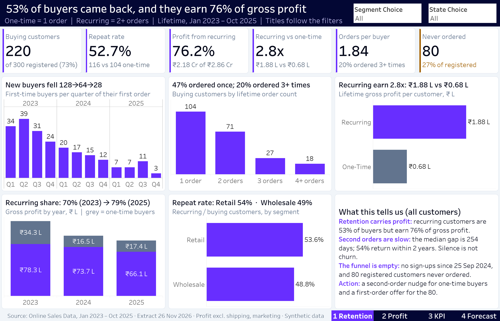
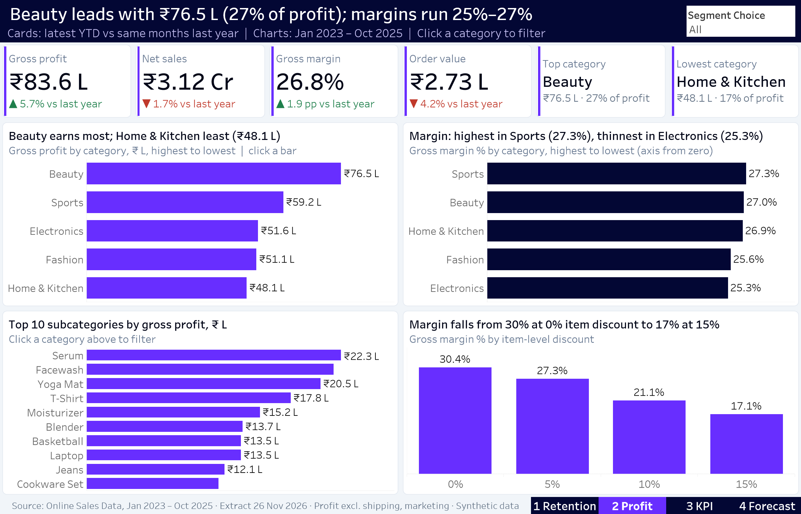
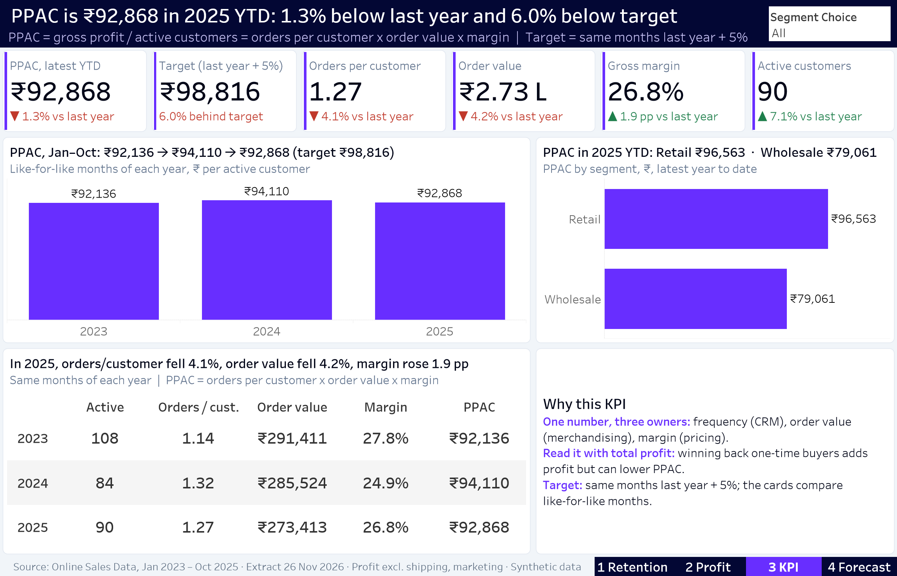
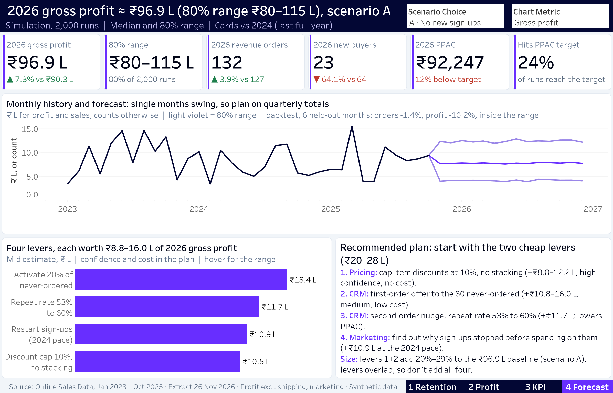

# RetailPulse-Tableau

A Tableau version of [RetailPulse-PBI](https://github.com/divitgautam/RetailPulse-PBI), generated entirely as code:
four dashboards that answer the same three business questions, built by scripts that an AI agent (Claude Code) can
drive through the [cwtwb](https://pypi.org/project/cwtwb/) MCP server. It is the Tableau counterpart of the Power BI
modelling MCP, and it was scored with the same 10-point rubric as the Power BI reports.

**Score: 10 / 10** on the dashboard scorecard (from 4.5 for v1), in the same visual style as the Power BI report. See [docs/review/scorecard.md](docs/review/scorecard.md).
Every number on the dashboards reconciles with an independent pandas calculation.

| | |
|---|---|
|  |  |
|  |  |

## The brief, answered

| Question | Dashboard | Answer |
|---|---|---|
| One-time vs recurring customers | 1 Retention | 116 recurring vs 104 one-time (52.7% repeat rate). Recurring customers earn 76% of gross profit, 2.8x a one-time buyer. No sign-ups since 25 Sep 2024: new buyers 128 → 64 → 28. |
| Profit by product category | 2 Profit | Beauty leads with ₹76.5 L (27%); Home & Kitchen trails at ₹48.1 L. Margins run 25–27%; margin falls from 30% at 0% item discount to 17% at 15%. |
| A KPI linking behaviour and profit | 3 KPI | Profit per active customer (PPAC) = orders per customer × order value × margin. ₹92,868 in 2025 YTD: 1.3% below last year and 6% below target. |
| What next | 4 Forecast | About ₹96.9 L of 2026 gross profit (80% range ₹80–115 L). Start with a 10% discount cap and a first-order offer to the 80 never-ordered customers (₹20–28 L). |

## What makes it score

- **Action titles that follow the filters.** Each title is a string calculation shown in a small text sheet, e.g. "Repeat rate: Retail 54% · Wholesale 49%".
- **KPI cards with change lines.** ▲▼ against the same months last year or against target, in green or red text at AA contrast. The two directions are separate fields, so each can carry its own colour.
- **Indian units throughout:** ₹, ₹ L and ₹ Cr.
- **Interaction:**
  - Segment and State parameters drive every sheet on pages 1–3, and the choice carries across pages.
  - Clicking a category filters its subcategories.
  - Scenario and metric controls on the forecast page.
  - Navigation buttons and phone layouts.
- **The Power BI look:** a full-width navy header with the controls in white boxes, boxed KPI cards with accent bars, and white rounded panels on a grey canvas.
- **Honest charts:** sorted bars from zero, direct labels, no dual axes, a forecast range with a stated backtest. A footer on every page gives the source, extract date and caveats.

## How it is built

```
RetailPulse-PBI parquet + notebook outputs ──► _build/build_extract.py ──► data/retailpulse.hyper     (Tableau Hyper API)
                                                                               │
                         _build/build_workbook.py + _build/twb_kit.py ◄────────┘                      (cwtwb)
                                   │
                                   ▼
                       RetailPulse-Tableau.twb ──► cwtwb validate ──► Tableau Desktop review ──► _build/reconcile.py
```

- **Extract:** one row per order line, plus one row per never-ordered customer (customer fields only), so a single
  datasource answers the retention question and the filters apply everywhere. Forecast, 2026 and lever tables come from
  the RetailPulse-PBI notebooks. Names, emails, phone numbers and birth dates are left out.
- **Workbook:** 173 calculated fields, 54 worksheets (hidden, so the four dashboards show as tabs) and 4 dashboards at 1400×900.
- **`twb_kit.py`:** reusable helpers for the next Tableau project:
  - Tableau formula builders: Indian units and ▲▼ change lines
  - cards, title sheets and brand-coloured bar charts
  - fixed pixel layouts
  - navigation buttons added after every dashboard exists
  - a guard that stops the build while Tableau has the extract locked

## MCP connection (tested)

| Check | Result |
|---|---|
| `cwtwb doctor` | All checks pass |
| MCP server over stdio (`_build/test_mcp.py`) | Starts, lists 83 tools, opens the workbook and lists its worksheets |
| Same tools from scripts (`cwtwb.mcp.tools_workbook`) | Used by `build_workbook.py`, so a build is reproducible without an agent |
| [tableau/tableau-mcp](https://github.com/tableau/tableau-mcp) (official) | Not used: it reads Tableau Cloud / Server content and needs a site |

To use it from Claude Code, copy `.mcp.json.example` to `.mcp.json`, set the path to your `.venv`, and open the folder.

## Reproduce

Requires Windows, Python 3.13 and Tableau Desktop 2026.x (the free edition opens the workbook).

```powershell
py -3.13 -m venv .venv
.\.venv\Scripts\python -m pip install -r requirements.txt
$env:RETAILPULSE_PARQUET = "<RetailPulse-PBI>\analysis\data"      # lines/products/customers.parquet
$env:RETAILPULSE_OUTPUTS = "<RetailPulse-PBI>\analysis\output"    # forecast and lever CSVs
.\.venv\Scripts\python _build\build_extract.py
.\.venv\Scripts\python _build\build_workbook.py                   # close Tableau first
.\.venv\Scripts\cwtwb validate RetailPulse-Tableau.twb
.\.venv\Scripts\python _build\reconcile.py                        # expected values for every number
```

Then open `RetailPulse-Tableau.twb` in Tableau Desktop.

## Lessons (Tableau as code)

- **Titles:** a measure in a worksheet title shows "*" when the chart has several marks. Put dynamic titles in their own text sheet.
- **Zone sizes:** Tableau sizes un-fixed tiled zones by their content and ignores relative weights, so give every zone a fixed pixel size and fit each sheet to its zone ("entire view").
- **Text sheets:** a text sheet shows only as many lines as its zone height allows. Size cards and title sheets for every line, or text is cut off with "..".
- **Labels:** custom labels resolve fields on the Text shelf, not the Tooltip shelf.
- **Filters across sheets:** a categorical filter shared across sheets by filter group did not apply in Desktop 2026.3. Global parameters with a boolean filter calculation work everywhere and carry across pages.
- **Top N filters:** rank by a row-level field (`SUM(field)`). Ranking by an aggregate calculation is rejected as an invalid filter.
- **Locks:** close Tableau before rebuilding, because it locks the `.hyper` file. Reconcile every number with an independent calculation.

## Licence

MIT for the scripts in this repo (see [LICENSE](LICENSE)). cwtwb is a separate AGPL-3.0 project, installed as a
dependency and not bundled here.
