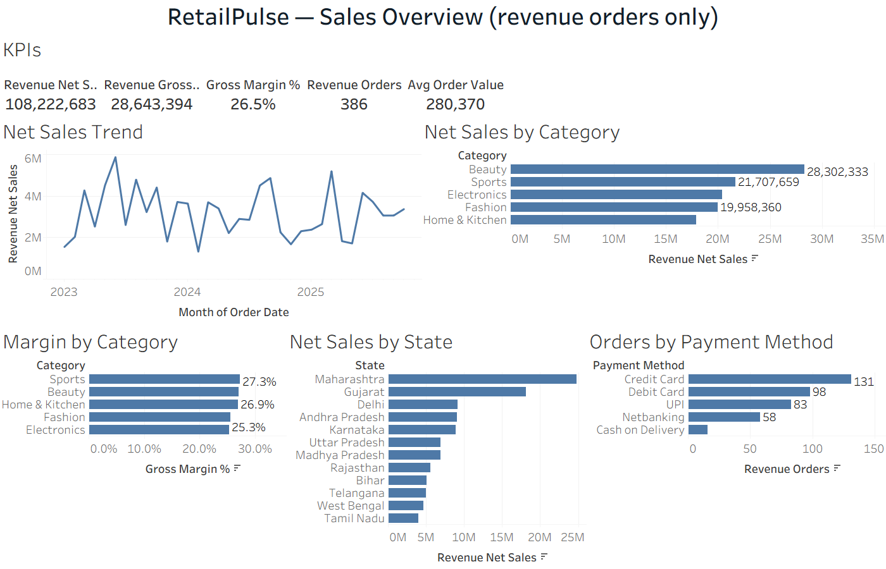

# RetailPulse-Tableau

An AI-built Tableau dashboard, generated as code. The same RetailPulse sales data as
[RetailPulse-PBI](https://github.com/divitgautam/RetailPulse-PBI), rebuilt for Tableau with a
repeatable pipeline that an AI agent (Claude Code) can drive through MCP, the way the Power BI
project is driven through the Power BI modeling MCP.



## What it shows

| Number | Value | Checked against |
|---|---|---|
| Revenue net sales | 108,222,683 | pandas on the source parquet: exact match |
| Revenue gross profit | 28,643,394 | exact match |
| Gross margin | 26.5% | exact match |
| Revenue orders | 386 | exact match |
| Average order value | 280,370 | exact match |

Category sales, category margins (Sports 27.3% highest, Electronics 25.3% lowest) and orders by payment method
(Credit Card 131 → Cash on Delivery 16) were also reconciled. "Revenue" means delivered and shipped lines, the
same rule as the Power BI model. The data is synthetic (see the RetailPulse-PBI README).

## How it is built

```
RetailPulse-PBI parquet ──► _build/build_extract.py ──► data/retailpulse.hyper   (Tableau Hyper API)
                                                            │
                         _build/build_workbook.py ◄─────────┘                     (cwtwb)
                                   │
                                   ▼
                       RetailPulse-Tableau.twb  ──►  open in Tableau Desktop 2026.x
```

- **Extract:** one denormalised `Sales` table (1,500 order lines) joined to products and customer geography.
  Names, emails, phone numbers and birth dates are left out.
- **Workbook:** 5 calculated fields (Revenue Net Sales, Revenue Gross Profit, Gross Margin %, Revenue Orders,
  Avg Order Value), 6 worksheets and a 1400×900 dashboard laid out as a title, a KPI row, a trend next to
  category sales, then three breakdowns. Generated without opening Tableau, then checked in Tableau Desktop 2026.3.
- **Validation:** `cwtwb validate` checks the file against Tableau's published TWB schema. The only warning is a
  known strict-schema item that Tableau Desktop accepts.

## Tooling (what was tested)

| Tool | Role | Result |
|---|---|---|
| [cwtwb](https://pypi.org/project/cwtwb/) 0.28.0 | Generates and edits `.twb` files; also an MCP server with 83 tools | Works. Charts, calculated fields, formats and dashboard layout all rendered correctly in Tableau 2026.3 |
| [Tableau Hyper API](https://pypi.org/project/tableauhyperapi/) | Writes the `.hyper` extract | Works |
| [tableau/tableau-mcp](https://github.com/tableau/tableau-mcp) (official) | Reads and queries content on Tableau Cloud / Server | Not used: needs a Cloud or Server site |

Because cwtwb already covers authoring, this repo uses it rather than a home-made generator.
Note that cwtwb is licensed AGPL-3.0; it is installed as a dependency and not bundled here.

## Reproduce

Requires Windows, Python 3.13 and Tableau Desktop 2026.x (the free edition is enough to open the workbook).

```powershell
py -3.13 -m venv .venv
.\.venv\Scripts\python -m pip install -r requirements.txt
$env:RETAILPULSE_PARQUET = "<RetailPulse-PBI>\analysis\data"   # folder with lines/products/customers.parquet
.\.venv\Scripts\python _build\build_extract.py
.\.venv\Scripts\python _build\build_workbook.py
.\.venv\Scripts\cwtwb validate RetailPulse-Tableau.twb
```

Then open `RetailPulse-Tableau.twb` in Tableau Desktop.

### Use it from Claude Code (MCP)

Copy `.mcp.json.example` to `.mcp.json`, set the path to your `.venv`, and open the folder in Claude Code.
`_build/test_mcp.py` is a smoke test: it starts the server, lists the tools and opens the workbook.

## Lessons from the test

- Let the layout be explicit. cwtwb's automatic layout stacked all six sheets in one strip too short for the
  bars; a container layout (`_build/layout.json`) fixed it.
- Use `MONTHTRUNC(Order Date)` for a timeline. `MONTH(Order Date)` folds every year into Jan–Dec.
- Rename the datasource caption; the blank template otherwise labels it after its Superstore sample.
- Always reconcile the KPIs against an independent calculation before trusting a generated dashboard.

## Licence

MIT for the scripts in this repo (see [LICENSE](LICENSE)). cwtwb is a separate AGPL-3.0 project.
